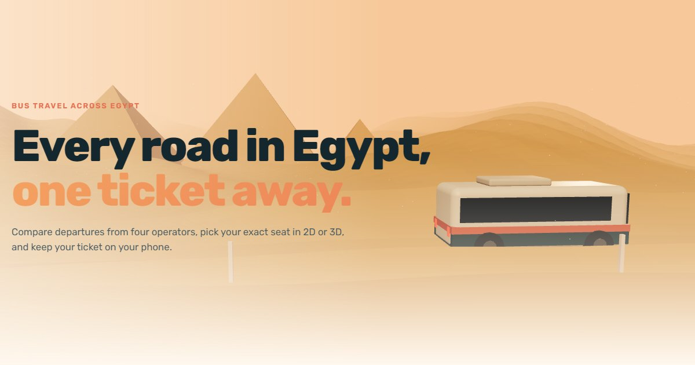

# Rihla — Egypt Travel

[](https://github.com/ramezGamel01/rihla-egypt-travel/actions/workflows/ci.yml)

Book bus trips across Egypt: search routes, compare departures, pick your exact seat on a 2D map or inside a 3D coach, and keep your ticket with its QR code. In English and Arabic, with light and dark themes.

**Live:** https://ramezgamel01.github.io/rihla-egypt-travel/



## What's inside

- **A 3D hero in three.js.** A coach drives across the desert past the pyramids at sunset. Switch to the dark theme and it's a moonlit night with headlights on. In Arabic the scene mirrors and the coach drives right to left.
- **A scroll-driven 3D journey.** Egypt as a raised map with the Nile and the Delta. Scroll and a coach drives Alexandria → Cairo → Luxor → Aswan → Hurghada, drawing its route as the camera follows.
- **Seats in 2D or 3D.** The seat map is a keyboard-navigable grid (arrow keys, one tab stop). The 3D view is an open cabin you can orbit and click, kept in sync with the map.
- **A real search flow.** Nine cities and sixteen routes, a date strip with the cheapest fare per day, filters for price, departure time, bus class, operator and amenities, and four sort orders.
- **Checkout.** Passenger and contact validation (Egyptian mobile numbers, Arabic or Latin names, Arabic-Indic digits), a ten-minute seat hold, a promo code, and card, wallet or pay-at-station options. It's a demo: no payment is taken and nothing leaves the browser.
- **Tickets.** A flippable 3D ticket with a QR code, add-to-calendar (.ics) and print. My bookings lists upcoming, past and cancelled trips, and cancelling releases the seats.
- **English and Arabic.** Full right-to-left layout, Arabic plural forms, and Arabic-Indic digits for numbers, prices and times.
- **Accessible and calm when asked.** Combobox, tabs, dialogs and the seat grid follow ARIA patterns. Animations follow the system's reduce-motion setting, with a toggle in the footer.

## Stack

React 19 and JavaScript, React Router, three.js with React Three Fiber and drei, Vite. Tests with Vitest and Testing Library. Deployed to GitHub Pages by GitHub Actions.

Trips are generated from a seeded timetable, so the same search always shows the same departures, prices and taken seats. Bookings and the demo account live in `localStorage`.

## Run locally

Requires Node.js 20 or newer.

```bash
npm install
npm run dev     # http://localhost:5173/rihla-egypt-travel/
npm test
npm run build
```

## Project structure

```
src/data/        cities, routes, operators and the seeded timetable
src/three/       the hero scene, the scroll journey and the 3D coach
src/components/  search form, city combobox, seat map, trip card, summary
src/pages/       home, trips, trip, checkout, ticket, bookings, sign in
src/i18n/        English and Arabic text, plurals and number formatting
src/state/       bookings store, theme, motion and the demo account
```

## Version 1

The first Rihla was 18 pages of HTML and CSS with no JavaScript: the seat picker counted seats and added up the price with CSS counters and `:has()`. It's kept at the [`v1-html-css`](https://github.com/ramezGamel01/rihla-egypt-travel/tree/v1-html-css) tag.

Trips, operators and prices are sample data.
